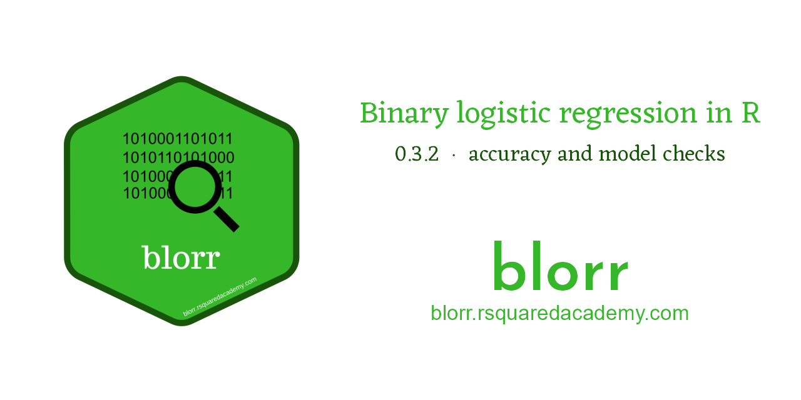

{fig-alt="blorr hex logo next to the tagline Binary logistic regression in R, the line 0.3.2, corrected results, the package name blorr and blorr.rsquaredacademy.com" width="100%"}

```{=html}
<style>
.ba-note{font-size:.88rem;color:#57606a;border-left:3px solid #d0d7de;padding-left:.75rem;margin:.5rem 0 1.25rem}
</style>
```

```{r}
#| label: setup
#| include: false
stopifnot(packageVersion("blorr") == "0.3.2")
library(blorr)
```

`blorr` 0.3.2 is on CRAN. `blorr` provides tools for binary logistic regression in R: model fit statistics, variable selection, bivariate analysis, weight of evidence, and the validation charts used in credit scoring (gains table, ROC curve, KS chart and Lorenz curve), all built around `glm()` objects.

The last blorr post covered 0.2.0 in 2019. Since then there have been four CRAN releases (0.2.1, 0.2.2, 0.3.0 and 0.3.1), and this one changes numbers that may already be in reports:

- Pseudo-R² values and the Gini index now use the rows the model was actually fitted on, and the Gini index follows the credit-scoring definition $2 \times \mathrm{AUC} - 1$.
- The likelihood ratio test uses the difference in residual degrees of freedom, so factor predictors get the right $p$-value.
- Gains tables, confusion matrices and segmentation rates were rebuilt around the fitted response.

If you report the Gini index, Cox–Snell or Nagelkerke R², or a likelihood ratio test from blorr, read the next three sections before you reuse those numbers. Everyone else can start at [What is new since 2019](#what-is-new-since-2019).

You can install it from CRAN with:

```{r}
#| label: install-cran
#| eval: false
install.packages("blorr")
```

You can see a full list of changes in the [release notes](https://blorr.rsquaredacademy.com/news/).

These fixes change results. In each case the new value agrees with the definition or with base R, so the new value is the one to report.

::: {.ba-note}
How we checked: Every number in this post was re-run against blorr 0.3.2 from CRAN; the release passed independent audits before submission.
:::

## Do the pseudo-R² values use the rows the model fitted?

Cox–Snell and Nagelkerke R² are functions of the fitted and intercept-only log-likelihoods and of the number of observations. If the data contain missing values, that number is the rows the model used, not the rows in the data frame.

`airquality` records ozone, solar radiation, wind and temperature for 153 days in New York; `Ozone` and `Solar.R` both contain missing values, so a logistic model of high ozone is fitted on fewer rows than the data has:

```{r}
#| label: r2-rows
aq <- airquality
aq$high <- as.integer(aq$Ozone > 100)
m_aq <- glm(high ~ Solar.R + Wind + Temp, data = aq, family = binomial)
c(rows_in_data = nrow(aq), rows_fitted = nobs(m_aq))
```

With $n = 111$ and the intercept-only model fitted on the same 111 rows, the two R² values are:

```{r}
#| label: r2-check
n <- nobs(m_aq)
ll <- as.numeric(logLik(m_aq))
ll0 <- as.numeric(logLik(glm(high ~ 1, data = model.frame(m_aq), family = binomial)))
cox_snell <- 1 - exp((2 / n) * (ll0 - ll))
nagelkerke <- cox_snell / (1 - exp((2 / n) * ll0))
c(cox_snell = cox_snell, nagelkerke = nagelkerke)
```

`blr_rsq_cox_snell()` and `blr_rsq_nagelkerke()` return the same two values, and `blr_model_fit_stats()` prints them in the fit statistics table:

```{r}
#| label: r2-fn
blr_model_fit_stats(m_aq)
```

In 0.3.2 the intercept-only model keeps the fitted model's response, offset and family/link, and `n` is `nobs(model)`. Earlier versions used the number of rows in the data frame, so missing values pulled both R² towards zero.

**What to do:** re-run pseudo-R² for any model fitted with missing data; the new values are the ones that match the definitions.

## Does the Gini index agree with the AUC?

The Gini index is usually reported beside the AUC in credit scoring, under the convention $G = 2 \times \mathrm{AUC} - 1$. For the bank marketing model below, the ROC curve is:

```{r}
#| label: gini-model
m <- glm(y ~ duration + loan + housing + campaign, data = bank_marketing, family = binomial)
g <- blr_gains_table(m)
```

```{r}
#| label: fig-roc
#| fig-cap: "ROC curve for the bank marketing model."
#| fig-alt: "ROC curve for the bank marketing model, with sensitivity on the y-axis against 1 minus specificity on the x-axis. The curve rises from 0% to 100% and stays well above the diagonal reference line."
#| fig-width: 6.5
#| fig-height: 5
blr_roc_curve(g)
```

The area under that curve, computed from the ranks of the fitted probabilities, and the Gini index are:

```{r}
#| label: gini-check
p <- fitted(m)
event <- bank_marketing$y == "1"
r <- rank(p)
n1 <- sum(event)
n0 <- sum(!event)
auc <- (sum(r[event]) - n1 * (n1 + 1) / 2) / (n1 * n0)
c(auc = auc, gini_from_auc = 2 * auc - 1, gini = blr_gini_index(m))
```

The last two numbers are equal. In 0.3.2 `blr_gini_index()` computes the AUC from the Mann–Whitney rank statistic and returns $2 \times \mathrm{AUC} - 1$, using only the rows the model was fitted on. Earlier versions returned the concentration index of the predicted probabilities, a different number for the same model, so a Gini reported before 0.3.2 cannot be compared with the AUC. The rank formula also avoids overflow on large models.

The gains table behind the curve now puts every observation in exactly one of ten deciles and counts events using the event level of the response:

```{r}
#| label: gini-gains
c(observations = sum(g$gains_table$total), events = sum(g$gains_table$`1`))
```

**What to do:** recompute any Gini index and report it as $2 \times \mathrm{AUC} - 1$ from now on.

## Does the likelihood ratio test use the right degrees of freedom?

A likelihood ratio test compares a full model with a reduced one. Its degrees of freedom are the difference in the number of estimated parameters, which is also the difference in residual degrees of freedom.

`job` has 12 levels, so adding it to a model with `duration` and `loan` adds 11 parameters:

```{r}
#| label: lr-models
m_red <- glm(y ~ duration + loan, data = bank_marketing, family = binomial)
m_full <- glm(y ~ duration + loan + job, data = bank_marketing, family = binomial)
c(resid_df_reduced = m_red$df.residual, resid_df_full = m_full$df.residual)
```

The test uses those two residual degrees of freedom:

```{r}
#| label: lr-test
print(blr_test_lr(m_full, m_red))
```

The same comparison in base R gives the same deviance, degrees of freedom and $p$-value:

```{r}
#| label: lr-anova
anova(m_red, m_full, test = "Chisq")
```

In 0.3.2 the degrees of freedom come from `df.residual` of the two models, and the $p$-value from the chi-square distribution with those degrees of freedom. Earlier versions could report the wrong degrees of freedom, and therefore the wrong $p$-value, for nested models with factor predictors. The test also checks that the reduced model is nested in the full model by comparing the fitted design spaces instead of assuming it.

**What to do:** re-run likelihood ratio tests that involve factor predictors; a $p$-value from an earlier version may be based on the wrong degrees of freedom.

## What is new since 2019?

### Does blorr stop when the model is not a binary logit?

blorr's tests and plots assume a binary response with a logit link. Version 0.3.2 checks the model before it calculates anything, instead of returning a number from a fit it cannot interpret:

```{r}
#| label: non-logit
#| error: true
m_q <- glm(y ~ duration, data = bank_marketing, family = quasibinomial)
blr_regress(m_q)
```

The same guard rejects prior weights other than 1, grouped binomial responses and fits stored without their model frame or response, and the selection functions reject these models before they refit anything.

### Can I draw the validation charts my way?

The data behind the Lorenz curve and the decile capture-rate chart is exported as a plain data frame. `blr_prep_lorenz_data()` returns the cumulative event and non-event shares; `blr_prep_dcrate_data()` returns the decile counts and the decile mean:

```{r}
#| label: prep-data
head(blr_prep_lorenz_data(m), 4)
head(blr_prep_dcrate_data(g), 4)
```

Both can go straight into `ggplot2`, `plotly` or any other plotting library, with the grouping and percentages already computed. The same applies to `blr_prep_roc_data()`, `blr_prep_kschart_data()` and `blr_prep_kschart_stat()`.

## Other improvements

- The Hosmer–Lemeshow test takes its degrees of freedom from the observed number of groups; the intercept-only model behind the fit statistics keeps the fitted response, offset and family/link; and package startup no longer checks the network ([#138](https://github.com/rsquaredacademy/blorr/issues/138), [#129](https://github.com/rsquaredacademy/blorr/issues/129), [#139](https://github.com/rsquaredacademy/blorr/issues/139)).
- `blr_pairs()` uses wide counters, so pair counts above the 32-bit integer limit no longer overflow, and its Somers' D and Goodman–Kruskal gamma use the correct denominators.
- Variance decomposition proportions in `blr_eigen_cindex()` sum to one, and condition indices stay finite for nearly collinear full-rank designs.
- Missing responses are no longer counted as non-events in segment, gains, confusion matrix and validation summaries, and the event rate in `blr_segment()` and `blr_segment_dist()` is the share of events within each level.
- `blr_woe_iv()` accepts character and numeric predictors, drops unused factor levels, applies a 0.5 continuity correction to levels with no events or no non-events, and drops rows with missing values.
- The stepwise AIC functions now return an intercept-only model when no predictor qualifies.

## What's next

These issues are known in 0.3.2. Most were found by an independent audit after the CRAN release. Each has a GitHub issue with a reproducible example, and each fix goes into blorr 0.3.3:

- A response with three levels is fitted silently, and the response summary drops a level ([#130](https://github.com/rsquaredacademy/blorr/issues/130)). Check `nlevels()` of the response before fitting. Fixed on the development branch.
- The delta deviance in `blr_residual_diagnostics()` uses the squared standardized Pearson residual ([#146](https://github.com/rsquaredacademy/blorr/pull/146)). Fixed on the development branch.
- The cells of `blr_segment_twoway()` are each cell's share of all observations, not the event rate within the cell. For a within-cell rate, use `tapply(y, list(a, b), mean)` ([#152](https://github.com/rsquaredacademy/blorr/issues/152)).
- `blr_segment()` and `blr_segment_dist()` round proportions to two decimals before using them, so their percentages and plots can be off by up to half a percentage point ([#153](https://github.com/rsquaredacademy/blorr/issues/153)). For exact shares, use `prop.table(table(x))` and `tapply(y, x, mean)`.
- The total information value printed by `blr_woe_iv()` adds up the rounded per-level values. For an accurate total, use a larger `digits`, for example `digits = 4` ([#155](https://github.com/rsquaredacademy/blorr/issues/155)).
- A factor response with only one observed level is treated as all non-events by the segment and weight-of-evidence functions. Check that both classes are present first ([#154](https://github.com/rsquaredacademy/blorr/issues/154)).

Fixes for #152–#155 are on the development branch. blorr 0.3.3, with all of these fixes, is planned after 2027-01-13.

## Acknowledgements

Thank you to everyone who contributed to `blorr` since the 2019 post by opening issues, reporting bugs and sending pull requests: [&#x0040;aravindhebbali](https://github.com/aravindhebbali), [&#x0040;DrMedfaresBrini](https://github.com/DrMedfaresBrini), [&#x0040;Irazall](https://github.com/Irazall), [&#x0040;LuiNov](https://github.com/LuiNov), [&#x0040;paleolimbot](https://github.com/paleolimbot), and [&#x0040;romainfrancois](https://github.com/romainfrancois).
