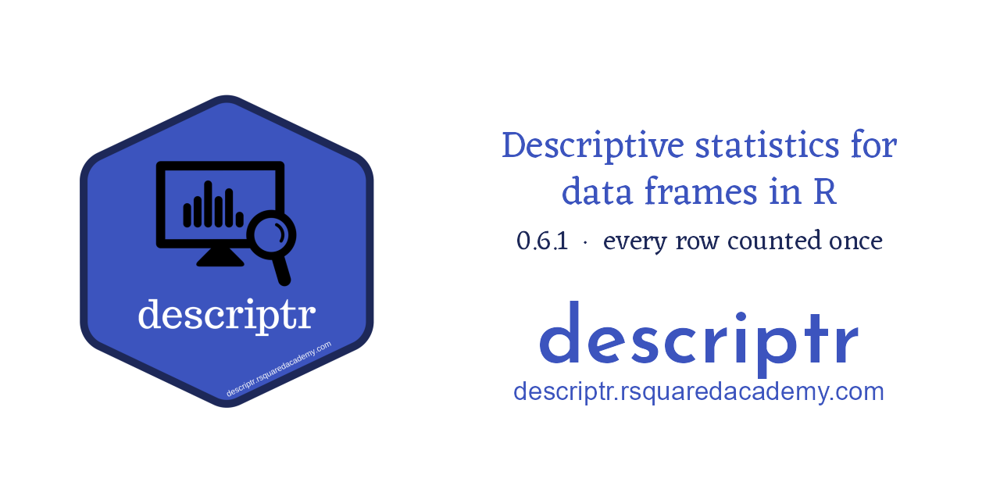

descriptr 0.6.1

{fig-alt="descriptr hex logo next to the tagline Descriptive statistics for data frames in R, the line 0.6.1, every row counted once, the package name descriptr and descriptr.rsquaredacademy.com" width="100%"}

```{r}
#| label: setup
#| include: false
library(descriptr)
stopifnot(packageVersion("descriptr") == "0.6.1")
```

descriptr summarises a data frame in the form an analyst reports it: measures of location and variation, frequency and cross tables, group summaries and the plots that go with them.

Version 0.6.1 is a correctness release. It counts each row once, keeps missing values in their own column, and accepts the text columns that data frames usually carry. The last descriptr post was in 2019; this release changes numbers that appear in reports, so it gets its own post:

- Frequency tables count every observation once, including values on a bin boundary, and gain a `closed` argument.
- The summary functions handle missing values per column, and a group summary reports the observations it used per group.
- Character columns work in frequency tables, cross tables, group summaries and categorical plots.

If you report frequencies, group summaries or cross tables from descriptr, start with the first three sections. Everyone else can go to [Other improvements](#other-improvements).

## Install from CRAN

```{r}
#| label: install
#| eval: false
install.packages("descriptr")
```

The full list of changes is in the [release notes](https://descriptr.rsquaredacademy.com/news/).

::: {.ba-note}
How we checked: every number in this post comes from a run of the code shown. The 0.6.1 figures are from CRAN 0.6.1; the comparison figures were re-run against 0.6.0 from the CRAN archive, from the same script.
:::

```{=html}
<style>
.ba-note{font-size:.88rem;color:#57606a;border-left:3px solid #d0d7de;padding-left:.75rem;margin:.5rem 0 1.25rem}
</style>
```

## Every order lands in exactly one bin

An analyst asks how orders spread across the discount bands. The answer should be a count per band, and the counts should add up to the number of orders.

Here is a month of orders from an online store. One row is one order:

```{r}
#| label: orders
set.seed(2026)
orders <- data.frame(
  order_id      = 1:600,
  region        = factor(sample(c("North", "South", "East", "West"), 600, TRUE, prob = c(.3, .25, .25, .2))),
  channel       = sample(c("Web", "Store", "Partner"), 600, TRUE),
  order_value   = round(rlnorm(600, meanlog = 6.6, sdlog = 0.55)),
  delivery_days = rpois(600, 4) + 1,
  discount_pct  = sample(0:30, 600, TRUE)
)
orders$order_value[sample(600, 40)] <- NA
orders$region[c(12, 140, 377)] <- NA
nrow(orders)
```

Five discount bands are enough to see the shape:

```{r}
#| label: freq-discount
ds_freq_table(orders, discount_pct, bins = 5)
```

Five bands, 600 orders, and the cumulative percent reaches 100.

In 0.6.0 the same call reported a cumulative frequency of 684 for those 600 orders, and the cumulative percent passed 100 to reach 114. An order on a boundary such as 6, 12 or 24 counted in both neighbouring bins.

A bin now includes its lower bound and excludes its upper bound, and the last bin is closed. `closed = "right"` moves the boundary to the other side. `closed = "both"` restores the earlier double counting when you need to reproduce an old table.

## Missing values stay in their own column

One column has 40 missing values. The other columns still describe all 600 orders:

```{r}
#| label: variation
ds_measures_variation(orders)
```

The `n` column reads 600 for `delivery_days`, `discount_pct` and `order_id`, and 560 for `order_value`, the column with the gaps. Each summary is computed from the values in its own column.

In 0.6.0 the same call dropped every row with a missing order value, so `n` read 560 for all four columns.

A group summary follows the same rule. It reports the orders it used and the ones it skipped, per region:

```{r}
#| label: group-summary
ds_group_summary(orders, region, order_value)
```

The Obs and Missing rows add up to each region's orders, and the three orders with no region label are left out of the table. In 0.6.0 a missing order value stopped the call with `missing values and NaN's not allowed if 'na.rm' is FALSE`.

A column with no values at all returns `NA` for every metric instead of an error or an infinity, and `decimals` now applies to data-frame input as it already did to a numeric vector.

## Text columns get cross tables

Most data frames keep region names as text rather than factors. They now work wherever a factor does:

```{r}
#| label: cross-table
ds_cross_table(orders, region, channel)
```

The table counts 597 orders and reports the 3 it dropped for a missing region label. The cells print percentages, and the object the function returns keeps the same values as proportions.

In 0.6.0 the call stopped with `channel is not a categorical variable`.

A numeric summary still needs a numeric column. Selecting a text column explicitly stops with an error that names it, while the tables and plots treat text as categorical.

The same two columns as a plot:

```{r}
#| label: fig-stacked
#| fig-cap: "November orders by region and channel."
#| fig-alt: "Stacked bar chart of November orders by region (East, North, South, West and a small bar for a missing region), with each bar split by channel: Partner, Store and Web."
#| fig-width: 7
#| fig-height: 4.5
plots <- ds_plot_bar_stacked(orders, region, channel, print_plot = FALSE)
plots[[1]]
```

## Row numbers point back to your data

An extreme value is only useful if you can find the row it came from:

```{r}
#| label: extreme-obs
ds_extreme_obs(orders, order_value)
```

The largest order, 3,498, is in row 398. In 0.6.0 the same call reported it as row 369, its position after the missing rows were removed. The index now refers to the row in the data frame you passed, and ties are reported on distinct rows.

## Other improvements

- `ds_gmean()` computes on the log scale, so large values return a finite number; `ds_gmean()` and `ds_hmean()` return `NA` with a warning for non-positive values ([#134](https://github.com/rsquaredacademy/descriptr/issues/134)).
- Frequency tables, cross tables, group summaries and categorical plots treat character columns as categorical, so results match the same data stored as factors ([#152](https://github.com/rsquaredacademy/descriptr/issues/152)).
- `ds_summary_stats()` and `ds_extreme_obs()` work when a variable has fewer than five non-missing values, and `ds_tailobs()` checks `n` against the non-missing count.
- `ds_freq_table()` rejects `bins` values such as `0`, `2.7` and `NA` with a clear error ([#131](https://github.com/rsquaredacademy/descriptr/issues/131)).
- The deprecated `ds_freq_cont()` forwards its variable correctly, `ds_twoway_table()` no longer prints a join message, and `ds_auto_summary_stats()` no longer prints a stray `NULL`.
- The release notes carry the rest.

## What's next

Known issue: data frames with columns named `var`, `vars` or `values` lose those columns in `ds_measures_variation()`, `ds_measures_symmetry()`, `ds_percentiles()` and `ds_tidy_stats()` ([#164](https://github.com/rsquaredacademy/descriptr/pull/164)); a fix is in review. Until it lands, rename those columns before calling the four functions.

## Documentation

Documentation and examples for every function are at [descriptr.rsquaredacademy.com](https://descriptr.rsquaredacademy.com). Report problems at [github.com/rsquaredacademy/descriptr/issues](https://github.com/rsquaredacademy/descriptr/issues).

## Acknowledgements

Thank you to [&#x0040;GegznaV](https://github.com/GegznaV) and [&#x0040;adam_medcalf](https://github.com/adam_medcalf), whose code and feedback shaped earlier releases.
