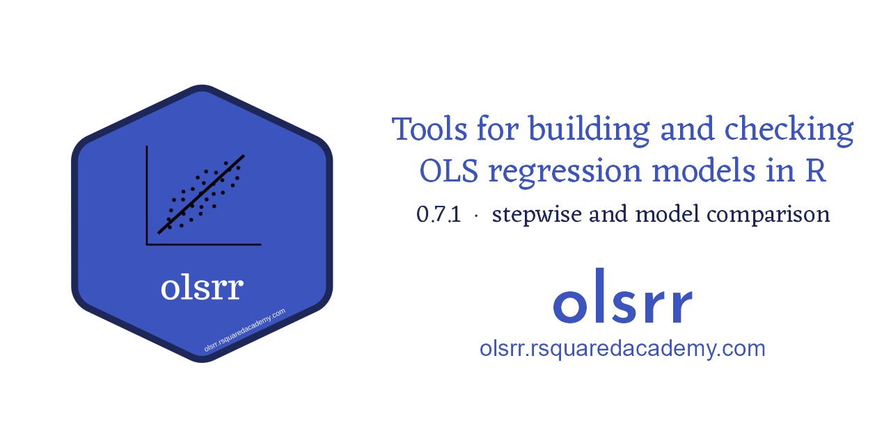

{fig-alt="olsrr hex logo next to the tagline Tools for building and checking OLS regression models in R, the line 0.7.1, corrected test results, the package name olsrr and olsrr.rsquaredacademy.com" width="100%"}


```{=html}
<style>
.ba-card{display:grid;grid-template-columns:1fr 1fr;gap:0;border:1px solid #d0d7de;border-radius:8px;overflow:hidden;margin:1rem 0 .5rem;font-size:.92rem}
.ba-card>div{padding:.75rem 1rem}
.ba-card .ba-before{background:#fff5f5;border-right:1px solid #d0d7de}
.ba-card .ba-after{background:#f3fbf5}
.ba-card h5{margin:0 0 .4rem;font-size:.8rem;letter-spacing:.04em;text-transform:uppercase;color:#57606a}
.ba-card code{font-size:.88rem}
.ba-card table{margin:0;width:100%}
.ba-card td{padding:.15rem .4rem;border:0}
.ba-card .chg{font-weight:700;background:#fff3b0;border-radius:3px;padding:0 .2rem}
.ba-call{font-size:.85rem;color:#57606a;margin:-.25rem 0 1rem}
.ba-note{font-size:.88rem;color:#57606a;border-left:3px solid #d0d7de;padding-left:.75rem;margin:.5rem 0 1.25rem}
@media (max-width:600px){.ba-card{grid-template-columns:1fr}.ba-card .ba-before{border-right:0;border-bottom:1px solid #d0d7de}}
</style>
```

```{r}
#| label: setup
#| include: false
stopifnot(packageVersion("olsrr") == "0.7.1")
library(olsrr)
```

`olsrr` 0.7.1 is on CRAN. `olsrr` provides tools for building and checking ordinary least squares regression models in R: regression summaries, variable selection, heteroskedasticity and normality tests, collinearity diagnostics, influence measures and residual plots, all built around `lm()` objects.

We don't usually write about patch releases, but this one deserves a post:

- Several test and summary results change: Holm-adjusted Breusch-Pagan $p$-values, the Cramér–von Mises normality test, and the residual MSE/RMSE in model summaries. If you report these numbers, please re-run your analyses.
- Every calculation and plot was checked against base R and reference packages (`car`, `lmtest` and `nortest`) for this release.
- It is the first `olsrr` post since our [introduction in 2019](../introducing-olsrr/index.qmd), so it also covers what has been added since then.

**Who should read what:** if you report Holm-adjusted Breusch-Pagan $p$-values, Cramér–von Mises normality tests or MSE/RMSE from `olsrr`, read [Behaviour changes](#behaviour-changes) first. Everyone else can skip to [What's new since 2019](#whats-new-since-2019).

You can install it from CRAN with:

```{r}
#| label: install-cran
#| eval: false
install.packages("olsrr")
```

You can see a full list of changes in the [release notes](https://github.com/rsquaredacademy/olsrr/releases/tag/v0.7.1).

## Behaviour changes

These fixes change numbers you may already have in reports. In each case 0.7.1 now agrees with the base R or reference implementation, so the new values are the ones to use.

::: {.ba-note}
How we checked: every number in this post was re-run on CRAN `olsrr` 0.7.0 and 0.7.1, and the release passed an independent audit against base R, `car`, `lmtest` and `nortest` before it was submitted.
:::

### Breusch-Pagan test: Holm-adjusted p-values

With `ols_test_breusch_pagan(..., rhs = TRUE, multiple = TRUE, p.adj = "holm")`, version 0.7.0 sorted the raw $p$-values and multiplied them by reversed ranks without the cumulative-maximum step of Holm's procedure. A predictor could keep an adjusted $p$-value that was too small and be wrongly flagged at $lpha = 0.05$. Version 0.7.1 uses `stats::p.adjust(p, "holm")`. In this three-predictor example the raw $p$-values are `0.0465`, `1.07e-05` and `0.0410`:

```{r}
#| label: bp-holm
set.seed(15)
n <- 60
z <- rnorm(n)
d <- data.frame(x1 = z + rnorm(n), x2 = z + rnorm(n), x3 = z + rnorm(n))
d$y <- rnorm(n) * exp(0.55 * z)

m_bp <- lm(y ~ x1 + x2 + x3, data = d)
ols_test_breusch_pagan(m_bp, rhs = TRUE, multiple = TRUE, p.adj = "holm")
```

```{=html}
<div class="ba-card" role="group" aria-label="Before and after: ols_test_breusch_pagan(m_bp, rhs = TRUE, multiple = TRUE, p.adj = "holm")">
<div class="ba-before"><h5>olsrr 0.7.0</h5><table><tr><td>x1</td><td><span class="chg">0.0465</span></td></tr><tr><td>x2</td><td>3.21e-05</td></tr><tr><td>x3</td><td>0.0819</td></tr></table></div>
<div class="ba-after"><h5>olsrr 0.7.1</h5><table><tr><td>x1</td><td><span class="chg">0.0819</span></td></tr><tr><td>x2</td><td>3.21e-05</td></tr><tr><td>x3</td><td>0.0819</td></tr></table></div>
</div>
<p class="ba-call">Same call on both CRAN versions: <code>ols_test_breusch_pagan(m_bp, rhs = TRUE, multiple = TRUE, p.adj = "holm")</code>. Changed values are highlighted.</p>
```

<details>
<summary>Code that produced both values</summary>

```r
# Run once with each version, e.g. in two sessions:
# remotes::install_version("olsrr", "0.7.0")   # then
# install.packages("olsrr")                    # 0.7.1
library(olsrr)
set.seed(15)
n <- 60
z <- rnorm(n)
d <- data.frame(x1 = z + rnorm(n), x2 = z + rnorm(n), x3 = z + rnorm(n))
d$y <- rnorm(n) * exp(0.55 * z)
m_bp <- lm(y ~ x1 + x2 + x3, data = d)
ols_test_breusch_pagan(m_bp, rhs = TRUE, multiple = TRUE, p.adj = "holm")$p
```

</details>


In 0.7.0, `x1` remained below `0.05` (`0.0465`) even though `x3` had a smaller raw $p$-value and adjusted to `0.0819`. In 0.7.1, `x1` is `0.0819`, matching `stats::p.adjust()`.

**What to do:** re-run any Holm-adjusted Breusch-Pagan tests; the 0.7.1 values match `stats::p.adjust()`.

### Normality test: Cramér–von Mises

In 0.7.0, `ols_test_normality()` compared the Cramér–von Mises statistic with a standard uniform distribution instead of a normal distribution with mean and standard deviation estimated from the residuals, so it rejected normality for almost any regression. Version 0.7.1 calls `nortest::cvm.test()`:

```{r}
#| label: cvm-normality
model <- lm(mpg ~ disp + hp + wt + qsec, data = mtcars)
ols_test_normality(model)
```

```{=html}
<div class="ba-card" role="group" aria-label="Before and after: ols_test_normality(lm(mpg ~ disp + hp + wt + qsec, mtcars))">
<div class="ba-before"><h5>olsrr 0.7.0</h5><table><tr><td>Cramér–von Mises W</td><td><span class="chg">2.8122</span></td></tr><tr><td>p-value</td><td><span class="chg">0.0000</span></td></tr></table></div>
<div class="ba-after"><h5>olsrr 0.7.1</h5><table><tr><td>Cramér–von Mises W</td><td><span class="chg">0.0764</span></td></tr><tr><td>p-value</td><td><span class="chg">0.2230</span></td></tr></table></div>
</div>
<p class="ba-call">Same call on both CRAN versions: <code>ols_test_normality(lm(mpg ~ disp + hp + wt + qsec, mtcars))</code>. Changed values are highlighted.</p>
```

<details>
<summary>Code that produced both values</summary>

```r
# Run once with each version, e.g. in two sessions:
# remotes::install_version("olsrr", "0.7.0")   # then
# install.packages("olsrr")                    # 0.7.1
library(olsrr)
model <- lm(mpg ~ disp + hp + wt + qsec, data = mtcars)
ols_test_normality(model)$cramer
```

</details>


In 0.7.1, the Cramér–von Mises result (`p = 0.2230`) agrees with `nortest::cvm.test(residuals(model))` and aligns qualitatively with the Shapiro-Wilk (`0.0600`) and Anderson-Darling (`0.1188`) tests on the same residuals. (See [What's next](#whats-next) about the Kolmogorov-Smirnov row.)

**What to do:** treat earlier Cramér–von Mises rejections from `olsrr` as unreliable and re-run the test.

### Residual MSE and RMSE

In 0.7.0, `ols_regress()` and `ols_model_performance()` divided the residual sum of squares by $n$ rather than by the residual degrees of freedom ([#221](https://github.com/rsquaredacademy/olsrr/issues/221), reported by [&#x0040;viqule11](https://github.com/viqule11)). For `lm(mpg ~ disp + hp + wt + qsec, data = mtcars)` ($n = 32$, 27 residual degrees of freedom) that gave `MSE = 5.8011` and `RMSE = 2.4085`. Version 0.7.1 reports `MSE = 6.8754` and `RMSE = 2.6221`, matching the ANOVA residual mean square and `summary(model)$sigma`.

```{=html}
<div class="ba-card" role="group" aria-label="Before and after: ols_regress(lm(mpg ~ disp + hp + wt + qsec, mtcars))">
<div class="ba-before"><h5>olsrr 0.7.0</h5><table><tr><td>MSE</td><td><span class="chg">5.8011</span></td></tr><tr><td>RMSE</td><td><span class="chg">2.4085</span></td></tr></table></div>
<div class="ba-after"><h5>olsrr 0.7.1</h5><table><tr><td>MSE</td><td><span class="chg">6.8754</span></td></tr><tr><td>RMSE</td><td><span class="chg">2.6221</span></td></tr></table></div>
</div>
<p class="ba-call">Same call on both CRAN versions: <code>ols_regress(lm(mpg ~ disp + hp + wt + qsec, mtcars))</code>. Changed values are highlighted.</p>
```

<details>
<summary>Code that produced both values</summary>

```r
# Run once with each version, e.g. in two sessions:
# remotes::install_version("olsrr", "0.7.0")   # then
# install.packages("olsrr")                    # 0.7.1
library(olsrr)
model <- lm(mpg ~ disp + hp + wt + qsec, data = mtcars)
r <- ols_regress(model)
c(mse = r$mse, rmse = r$rmse)
```

</details>


**What to do:** expect slightly larger MSE and RMSE values; they now match base R.

## What's new since 2019

### Stepwise Selection with Locked Predictors

Between versions 0.6.0 and 0.7.1, the variable selection family expanded to cover $p$-values, AIC, SBC (BIC), Sawa's BIC (`sbic`), $R^2$, and adjusted $R^2$. All forward, backward, and both-direction selectors now accept `include` and `exclude` arguments (by name or column index) so baseline covariates or confounders stay in the model throughout selection.

On the `surgical` dataset, locking `age` and `alc_heavy` via `include` keeps both predictors in the base model (Step 0, `AIC = 795.956`) and through every subsequent addition and removal step, even though `age` itself has $p = 0.473$ in the final fit:

```{r}
#| label: step-include
m_surg <- lm(
  y ~ bcs + pindex + enzyme_test + liver_test + age + gender + alc_mod + alc_heavy,
  data = surgical
)
ols_step_both_aic(m_surg, include = c("age", "alc_heavy"))
```

### Ten-Panel Diagnostic Grid

`ols_plot_diagnostics()` gathers ten residual, fit, leverage, and influence views for an `lm` object: residuals vs fitted values, deleted studentized residuals vs predicted values, studentized residuals vs leverage, normal Q-Q plot, actual vs fitted values, Cook's D chart, centered fit spread, residual spread, residual histogram, and residual box plot.

Calling `ols_plot_diagnostics(model)` directly pages the panels in 2×2 grids (and in 0.7.1 draws cleanly inside scripts, functions, and loops as well as at the top level). Setting `print_plot = FALSE` returns the ten `ggplot` objects without drawing them first, so they can be arranged in a single layout:

```{r}
#| label: diag-grid
#| fig-width: 9
#| fig-height: 13.5
#| fig-alt: "Ten-panel regression diagnostic grid for mpg ~ disp + hp + wt + qsec on mtcars, arranged in five rows of two panels: Residual vs Fitted Values, Deleted Studentized Residual vs Predicted Values, Outlier and Leverage Diagnostics, Normal Q-Q Plot, Actual vs Fitted for mpg, Cook's D Chart, centered fit spread and residual spread plots, Residual Histogram with normal curve, and Residual Box Plot."
model <- lm(mpg ~ disp + hp + wt + qsec, data = mtcars)
panels <- ols_plot_diagnostics(model, print_plot = FALSE)
gridExtra::grid.arrange(grobs = panels, ncol = 2, top = "Regression Diagnostics")
```

### Model Performance and Multi-Model Comparison

Added in 0.7.0 and refined in 0.7.1, `ols_model_performance()` reports fit metrics for a single model, while `ols_compare_model_performance()` places competing models side by side across $R^2$, adjusted $R^2$, predicted $R^2$, AIC, SBC, SBIC, RMSE, and residual standard error (`sigma`):

```{r}
#| label: model-compare
m1 <- lm(mpg ~ wt + hp, data = mtcars)
m2 <- lm(mpg ~ wt + hp + qsec, data = mtcars)
m3 <- lm(mpg ~ wt + hp + qsec + disp, data = mtcars)

ols_compare_model_performance(m1, m2, m3)
```

### Weighted Linear Regression in `ols_regress()`

In 0.7.1, `ols_regress()` supports weighted linear models fitted with `lm(..., weights = ...)`, matching base R's `summary()`, `anova()`, and `confint()` for coefficient estimates, standard errors, $t$-statistics, confidence intervals, $R^2$, residual standard error, the ANOVA table, standardized betas, and weighted predicted $R^2$:

```{r}
#| label: weighted-regress
d_wt <- mtcars
d_wt$w <- seq_len(nrow(d_wt)) / 8

m_w1 <- lm(mpg ~ wt + hp, data = d_wt, weights = w)
ols_regress(m_w1)
```

## Other improvements

- `ols_press()` weights the squared deleted residuals for weighted models, so `ols_pred_rsq()` no longer moves towards 1 when the weights are rescaled. For the weighted model shown above, multiplying the weights by 10 changed predicted $R^2$ from `0.9077` to `0.9908` in 0.7.0; in 0.7.1 both are `0.7859`.
- `ols_plot_resid_hist()` draws the bars with the same breaks as the normal curve. Previously the curve could be drawn at about half its correct height (`0.54` of the expected peak for `lm(hwy ~ displ + cty + year, data = ggplot2::mpg)`).
- `ols_plot_comp_plus_resid()` keeps every predictor for single-predictor and no-intercept models; 0.7.0 dropped a column and plotted a single point.
- `ols_test_outlier()` caps Bonferroni-adjusted $p$-values at 1 (0.7.0 could report values such as `6.62`).
- Information criteria count parameters with the model rank, which fixes factor predictors and rank-deficient models; `ols_aic(corrected = TRUE)` matches the AICc formula ([#224](https://github.com/rsquaredacademy/olsrr/issues/224), [#170](https://github.com/rsquaredacademy/olsrr/issues/170), reported by [&#x0040;comatrion](https://github.com/comatrion)), and Mallows' $C_p$ is correct for factor predictors ([#92](https://github.com/rsquaredacademy/olsrr/issues/92), reported by [&#x0040;cccfran](https://github.com/cccfran)) and in `ols_step_all_possible()` ([#215](https://github.com/rsquaredacademy/olsrr/issues/215), reported by [&#x0040;LSantanaZA](https://github.com/LSantanaZA)).
- Stepwise selection handles transformed and factor predictors in refits ([#244](https://github.com/rsquaredacademy/olsrr/issues/244), [#246](https://github.com/rsquaredacademy/olsrr/issues/246)), forward selection on saturated models ([#199](https://github.com/rsquaredacademy/olsrr/issues/199), reported by [&#x0040;hirscht](https://github.com/hirscht)), ties ([#206](https://github.com/rsquaredacademy/olsrr/issues/206), reported by [&#x0040;kaygmz](https://github.com/kaygmz)) and aliased terms ([#172](https://github.com/rsquaredacademy/olsrr/issues/172), reported by [&#x0040;yayyb](https://github.com/yayyb)).
- Models fitted with `na.action = na.exclude` or with weights are handled consistently across plots and tests; diagnostics whose formulas assume unweighted least squares now stop with a clear error for weighted fits ([#236](https://github.com/rsquaredacademy/olsrr/issues/236)).

## What's next

Two issues remain open and will be fixed in 0.7.2. The Kolmogorov-Smirnov row of `ols_test_normality()` is not Lilliefors-corrected, so its $p$-value is too large when the mean and standard deviation are estimated from the residuals ([#254](https://github.com/rsquaredacademy/olsrr/issues/254)). Until then, use the Shapiro-Wilk, Cramér–von Mises or Anderson-Darling rows, or call `nortest::lillie.test(residuals(model))`. Two panels of `ols_plot_diagnostics()` also share the title "Residual Fit Spread Plot" ([#253](https://github.com/rsquaredacademy/olsrr/issues/253)); the plotted values and axis labels are correct.

## Acknowledgements

A big thank you to everyone who contributed to `olsrr` since 2019 by opening issues, reporting bugs and sending pull requests: [&#x0040;AminHP](https://github.com/AminHP), [&#x0040;aravindhebbali](https://github.com/aravindhebbali), [&#x0040;ashimkapoor](https://github.com/ashimkapoor), [&#x0040;bappa10085](https://github.com/bappa10085), [&#x0040;ButlerMSDA](https://github.com/ButlerMSDA), [&#x0040;CarlosJara72](https://github.com/CarlosJara72), [&#x0040;comatrion](https://github.com/comatrion), [&#x0040;davidreilly007](https://github.com/davidreilly007), [&#x0040;DrMondesire](https://github.com/DrMondesire), [&#x0040;grantbrown](https://github.com/grantbrown), [&#x0040;hirscht](https://github.com/hirscht), [&#x0040;hkincaid](https://github.com/hkincaid), [&#x0040;iankelk](https://github.com/iankelk), [&#x0040;jmberros](https://github.com/jmberros), [&#x0040;jorgevallejo](https://github.com/jorgevallejo), [&#x0040;jst04004](https://github.com/jst04004), [&#x0040;jtheog](https://github.com/jtheog), [&#x0040;kaygmz](https://github.com/kaygmz), [&#x0040;linusjf](https://github.com/linusjf), [&#x0040;LSantanaZA](https://github.com/LSantanaZA), [&#x0040;modche](https://github.com/modche), [&#x0040;Molina-Valero](https://github.com/Molina-Valero), [&#x0040;mwm-cbus](https://github.com/mwm-cbus), [&#x0040;njrockwood](https://github.com/njrockwood), [&#x0040;paleolimbot](https://github.com/paleolimbot), [&#x0040;PsychlytxTD](https://github.com/PsychlytxTD), [&#x0040;qwertytam](https://github.com/qwertytam), [&#x0040;sblanco74](https://github.com/sblanco74), [&#x0040;sckott](https://github.com/sckott), [&#x0040;SunsetBlvd](https://github.com/SunsetBlvd), [&#x0040;tikuma-lsuhsc](https://github.com/tikuma-lsuhsc), [&#x0040;vasili111](https://github.com/vasili111), [&#x0040;viqule11](https://github.com/viqule11), [&#x0040;williamlai2](https://github.com/williamlai2), and [&#x0040;yayyb](https://github.com/yayyb).
