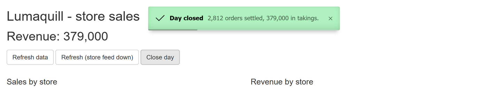

standby 0.2.2

{fig-alt="standby hex logo next to the tagline Alerts, notifications and loading screens in Shiny, the line 0.2.2, colours and checked arguments, the package name standby and standby.rsquaredacademy.com" width="100%"}

```{r setup}
#| include: false
stopifnot(packageVersion("standby") == "0.2.2")
library(standby)
library(htmltools)
library(shiny)
```

`standby` gives a Shiny app its alerts, notifications, modals, tooltips and loading screens. Each function wraps a browser library in an R call, so a loader is added to the UI and a toast to the server in one line.

Version 0.2.2 is on CRAN. Version 0.2.1 was never published; its changes ship here, and this is the first `standby` post since the [introduction in 2023](../introducing-standby-alerts-notifications-tooltips-loading-screens-shiny/index.qmd). Three things in this release change what users see:

- Every loader uses the colour it is given, and each widget writes its rules under its own id, so two loaders of the same type no longer share one rule ([Colours](#colours)).
- The eight message senders check their arguments in R, so a mistyped position or an effect from another layout stops with a message that names the argument and the values it accepts ([Arguments](#arguments)).
- The loader catalogue draws what its names promise: twenty three-dots types animate, the music coin appears, and SpinKit swing draws two dots ([Loaders](#loaders)).

If you set loader colours or toast positions, read Colours and Arguments first.

You can install it from CRAN with:

```{r install}
#| eval: false
install.packages("standby")
```

The full list of changes is in the [release notes](https://standby.rsquaredacademy.com/news/).

::: {.callout-note appearance="simple"}
How we checked: every chunk output below was produced by the CRAN build of `standby` 0.2.2 in a fresh library. The screenshots, markup and element counts labelled 0.2.0 come from the CRAN build of `standby` 0.2.0, installed from the CRAN archive into a second library, running the same calls. The dashboard in the screenshots is the `app.R` beside this post: a small store chain, simulated data, one seed, so the first view is the same on every run. The release passed two audit rounds before submission; the finding ids in the release notes (`fx1` for the first round, `aud2` for the second) record both.
:::

## Colours {#colours}

Two charts on one dashboard ask for their own loader colour. Why did both come out the same?

{fig-alt="Four loader close-ups in two rows, under the panel headings Sales by store and Revenue by store. Top row, standby 0.2.0: both loaders show three light purple dots. Bottom row, standby 0.2.2: the Sales by store loader shows three orange dots and the Revenue by store loader shows three teal dots."}

Version 0.2.2 gives every call its own element id and writes the colour rule under that id, so the second call cannot overwrite the first:

```r
threeDots(tableOutput("sales"),
          type = "flashing", color = "#c2410c")
threeDots(plotOutput("revenue_chart"),
          type = "flashing", color = "#0f766e")
```

The rule also carries the faded shade the animation uses. It is computed from the colour you passed: `#c2410c` at 20% opacity is `rgba(194, 65, 12, 0.2)`, and the hue is kept.

::: {.callout-note collapse="true"}
### The generated CSS

```{r scoped-css}
scoped_css <- function(x) cat(as.character(htmltools::renderTags(x)$head))
scoped_css(threeDots(tableOutput("sales"), type = "flashing", color = "#c2410c"))
scoped_css(threeDots(plotOutput("revenue_chart"), type = "flashing", color = "#0f766e"))
```
:::

In 0.2.0 both calls wrote their rule under the same id, `#threedots`, and the dots drew in the bundle's default colour whatever each call passed. The top row above is the same app, the same two calls, run against that build.

`vizLoad(type = "dots")` takes its colour in the markup. In 0.2.0 it accepted `color` and passed no colour to the dots. Version 0.2.2 writes the colour into each dot and derives the dark phase from it: `steelblue` resolves once to `#4682B4` and the dark phase is `rgba(32, 59, 81, 1)`. Each `vizLoad()` call has its own wrapper id, `viz-1`, `viz-2` and so on.

Colours are checked in R before they reach the page. Named R colours, hex with 3, 4, 6 or 8 digits, `rgb()`/`rgba()` and `hsl()`/`hsla()`, including the modern syntax, are all accepted; a malformed value stops with a message that names the argument.

## Arguments {#arguments}

The app closes the day and sends a toast to the top centre. How does a typo in the position not slip through?

{fig-alt="The Lumaquill dashboard with a green toast across the top centre reading Day closed, 2,812 orders settled, 379,000 in takings."}

```r
toast(
  "Day closed",
  "2,812 orders settled, 379,000 in takings.",
  type = "success",
  position = "topCenter"
)
```

The message senders now check their arguments in R. Eight of them validate the values that reach the browser: `alertify_alert()`, `alertify_notify()`, `bootBox()`, `tingle()`, `notify()`, `toast()`, `notice()` and `microTip()`.

If your app passes a value a sender used to ignore, it now stops in R and names the argument. Run the app once and correct the argument the message names.

```{r error-position}
#| error: true
tryCatch(
  toast("Payment captured", type = "success", position = "topcenter"),
  error = function(e) {
    writeLines(c("Error:", strwrap(conditionMessage(e), 62)))
  }
)
```

The error names the argument and the values it accepts. `topCenter` is the spelling the toast recognises. In 0.2.0 an invalid value was silently ignored or failed in the browser.

```{r error-effect}
#| error: true
notice("Invoice 4471 approved", layout = "growl", effect = "flip")
```

`flip` belongs to the `attached` layout. The error lists the effects that `growl` accepts, so the fix is in the message.

The same release validates types, logical flags, delays, sizes and message content across the eight senders. A value that cannot describe the widget fails in the R call that made it.

## Loaders {#loaders}

The order table has been loading for long enough to read the spinner. Why is one swing dot darker than the other?

::: {layout-ncol=2}
{fig-alt="Close-up of the swing loader in 0.2.0: two dots, the small one noticeably darker than the large one because it is drawn twice."}

{fig-alt="Close-up of the swing loader in 0.2.2: two dots at the same light blue opacity."}

{fig-alt="Close-up of the wander loader in 0.2.0: three cubes, the left one darker than the other two."}

{fig-alt="Close-up of the wander loader in 0.2.2: three cubes at the same light blue opacity."}
:::

Version 0.2.2 emits each dot and cube once, so a translucent colour has nothing to overlap:

```r
spinkit(tableOutput("open_orders"), type = "swing",
        color = "rgba(37, 99, 235, 0.45)")
spinkit(plotOutput("stock"), type = "wander",
        color = "rgba(37, 99, 235, 0.45)")
```

In 0.2.0 `swing` carried a third dot and `wander` a fourth cube, each with the same animation delay as the first, so the extra element sat exactly on top of it. At 45% opacity the overlap reads as a darker dot; the frames above show it. Translucent colours no longer show a doubled opacity, and the travel of `wander` scales with the widget size.

::: {.callout-note collapse="true"}
### Count the dots and cubes

```{r spinkit-counts}
count_class <- function(x, class) {
  html <- as.character(htmltools::renderTags(x)$html)
  lengths(regmatches(html, gregexpr(class, html)))
}
c(
  swing  = count_class(spinkit(tableOutput("open_orders"), type = "swing"), "sk-swing-dot"),
  wander = count_class(spinkit(plotOutput("stock"), type = "wander"), "sk-wander-cube")
)
```

The 0.2.0 run of the same two calls gives `swing = 3` and `wander = 4`.
:::

All twenty `threeDots()` types render their animation. The six types that project shadows (`pulse`, `carousel`, `typing`, `bricks`, `fire` and `falling`) centre in a separate wrapper so the projected dots stay solid; the 0.2.2 `threeDots()` source names exactly those six. Emoji types keep a bounded width; ring and orbit centres stay transparent.

`loaders(type = "music")` draws the animated coin loader: a coin that flips as it turns and shows `Hey!`, `Let's!`, `Oh!` and `Go!` on its faces.

```r
loaders(tableOutput("day_close"), type = "music")
```

{fig-alt="A dark full-screen overlay with a large coin in the centre. The coin turns and its face alternates between the words Hey!, Let's!, Oh! and Go!."}

In 0.2.0 the loader element carried no `data-hey-oh` attribute, which is the attribute the coin animation is attached to. Version 0.2.2 adds it and keeps the custom text beside the loader. Shared centring works whatever order the spinner families are added to the UI.

## Other improvements

- `loaders(style =)` is drawn for a documented set of types: `half` for `default`, `inverse` for `default` and `bar`, `rounded` for `bar` and `bar-ping-pong`, and `blink` for `default`, `bar` and `border`. A combination outside that set now stops with the valid types; `style = "inverse"` with `type = "music"` reports `Supported types: default, bar.`
- `spinkit(size =)` requires a positive CSS length, and numeric or unitless sizes are normalised to pixels for every type, so the wander travel follows the widget size.
- `notice(effect = NULL)` picks the default for its layout (jelly for growl, flip for attached, slidetop for bar), and each type has its own foreground and background colours across every effect and layout.
- `bootBox()` accepts `sm`, `lg` and `xl` as size aliases and `backdrop = "static"`; extra-large dialogs keep a Bootstrap 3 fallback up to 1140 pixels, and `close_on_escape = FALSE` keeps the dialog open on Escape.
- `notify()` treats numeric widths as pixels (`width = 500` becomes `500px`), passes pointer events through with `non_blocking = TRUE`, and displays normally when the title or the text is `NULL`.
- `toast(type = "question")` uses the bundled question toast, `duration = Inf` keeps a toast open, and numeric CSS sizes use a dot decimal separator even with `options(OutDec = ",")`.
- `alertify_alert()` replaces the previous type class when a dialog is reused, and `alertify_notify(delay = Inf)` keeps a notification open.
- `tingle()` destroys closed modals and removes their listeners; `microTip()` handles literal ids such as `a.b` and `a:b` and ignores a missing element.
- The documented defaults for the senders now match the arguments, and the README alert examples are corrected.

## What's next

The issue tracker has no open reports against `standby`, and no known issue affects results in 0.2.2. The next release will be 0.2.3.

The supported domain is the documented types, colour formats, positive SpinKit sizes and the type-specific VizLoad sizes and loader options, in a modern browser with CSS animation enabled and room for the requested graphic. Transparent colours hide graphics by design, and emoji colours stay native.

## Acknowledgements

`standby` bundles CSS and JavaScript from Three Dots, SpinKit, Loading Visualization, CSS Loaders, AlertifyJS, BootBox, MicroTip, Notification Styles, PNotify, Tingle and iziToast. Thanks to their authors.
