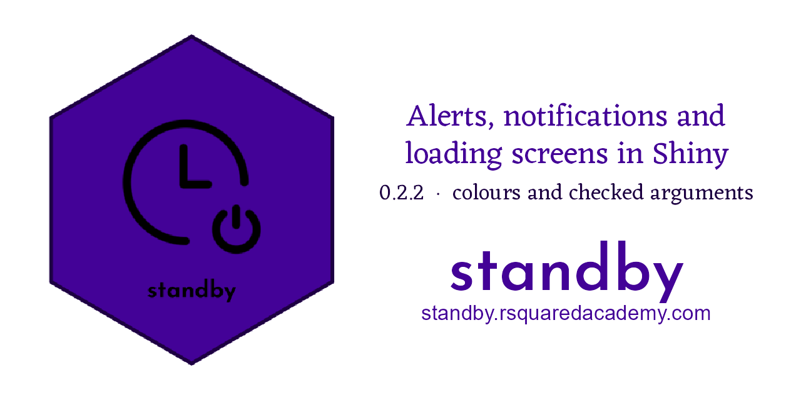

standby 0.2.2

{fig-alt="standby hex logo next to the tagline Alerts, notifications and loading screens in Shiny, the line 0.2.2, colours and checked arguments, the package name standby and standby.rsquaredacademy.com" width="100%"}

```{r setup}
#| label: setup
#| include: false
stopifnot(packageVersion("standby") == "0.2.2")
library(standby)
library(htmltools)
```

`standby` gives a Shiny app its alerts, notifications, modals, tooltips and loading screens. Each function wraps a browser library in an R call, so a loader is added to the UI and a toast to the server in one line.

Version 0.2.2 is on CRAN. Version 0.2.1 was never published; its changes ship here, and this is the first `standby` post since the [introduction in 2023](../introducing-standby-alerts-notifications-tooltips-loading-screens-shiny/index.qmd). Three things in this release change what users see:

- Every loader uses the colour it is given, and each widget scopes its rules to its own id, so two loaders on one page no longer share the last colour set ([Colours](#colours)).
- The eight message senders check their arguments in R, so a mistyped position or an effect from another layout stops with a message that names the argument and the values it accepts ([Arguments](#arguments)).
- The loader catalogue draws what its names promise: twenty three-dots types animate, the music coin appears, and SpinKit swing draws two dots ([Loaders](#loaders)).

You can install it from CRAN with:

```{r install}
#| label: install
#| eval: false
install.packages("standby")
```

The full list of changes is in the [release notes](https://standby.rsquaredacademy.com/news/).

::: {.callout-note appearance="simple"}
How we checked: every output below was produced by the CRAN build of `standby` 0.2.2 in a fresh library. The release passed two audit rounds before submission; the finding ids in the release notes (fx1 for the first round, aud2 for the second) record both.
:::

The examples follow the order desk of a small distributor: three regions, and a backlog generated with a fixed seed.

```{r desk}
#| label: desk
set.seed(20261128)
desk <- data.frame(
  region = c("north", "south", "west"),
  open_orders = sample(40:120, 3)
)
busiest <- desk$region[which.max(desk$open_orders)]
desk
```

## Colours {#colours}

Two charts on the dashboard ask for their own loader colour. Why do both loaders appear in the same colour?

In 0.2.0 the rules for a loader type were shared, so two loaders of the same type ended up with the same colour. Version 0.2.2 gives every call its own element id and writes the rule under that id. The stylesheet a call adds to the page shows both parts:

```{r scoped-css}
#| label: scoped-css
scoped_css <- function(x) cat(as.character(htmltools::renderTags(x)$head))
scoped_css(threeDots(paste0("open_orders_", busiest), type = "flashing", color = "#c2410c"))
scoped_css(threeDots("quote_total", type = "flashing", color = "#0f766e"))
```

Two calls, two ids, two colours. The faded shade is computed from the colour you passed: `#c2410c` at 20% opacity is `rgba(194, 65, 12, 0.2)`, and it keeps the hue.

`vizLoad()` writes the colour into the markup, which is where the dots loader reads it:

```{r vizload-dots}
#| label: vizload-dots
cat(as.character(htmltools::renderTags(vizLoad("claims_chart", type = "dots", color = "steelblue", size = "small"))$html))
```

The colour name resolves once, to `#4682B4`, and the dark phase is derived from it as `rgba(32, 59, 81, 1)`. In 0.2.0 the dots loader accepted `color` and did not apply it. The wrapper id (`viz-1`) is what keeps the next loader of the same type independent.

Colours are checked in R before they reach the page. Named R colours, hex with 3, 4, 6 or 8 digits, `rgb()`/`rgba()` and `hsl()`/`hsla()`, including the modern syntax, are all accepted; a malformed value stops with a message that names the argument.

## Arguments {#arguments}

The app sends a toast to the top centre. It appears in the middle, the typo goes unnoticed, and the next one does the same. Can the call fail instead?

The message senders now check their arguments in R. Eight of them validate the values that reach the browser: `alertify_alert()`, `alertify_notify()`, `bootBox()`, `tingle()`, `notify()`, `toast()`, `notice()` and `microTip()`.

```{r error-position}
#| label: error-position
#| error: true
toast("Payment captured", type = "success", position = "topcenter")
```

The error names the argument and the values it accepts. `topCenter` is the spelling the toast recognises.

```{r error-effect}
#| label: error-effect
#| error: true
notice("Invoice 4471 approved", layout = "growl", effect = "flip")
```

`flip` belongs to the `attached` layout. The error lists the effects that `growl` accepts, so the fix is in the message.

```{r error-music}
#| label: error-music
#| error: true
loaders("orders_table", type = "music", style = "inverse")
```

Each style is drawn for a documented set of types: `half` for `default`, `inverse` for `default` and `bar`, `rounded` for `bar` and `bar-ping-pong`, and `blink` for `default`, `bar` and `border`. A combination outside that set now stops instead of drawing nothing.

The same release validates types, logical flags, delays, sizes and message content across the eight senders. A value that cannot describe the widget fails in the R call that made it.

## Loaders {#loaders}

The order table has been loading for long enough to read the spinner. Why does the animation that should swing two dots draw four?

In 0.2.0 the markup carried each dot and cube twice, and a translucent colour showed the overlap. 0.2.2 emits each dot and cube once:

```{r spinkit-counts}
#| label: spinkit-counts
cat(as.character(htmltools::renderTags(spinkit("orders_table", type = "swing", color = "#0f766e"))$html))
cat(as.character(htmltools::renderTags(spinkit("orders_table", type = "wander", color = "#0f766e"))$html))
```

Swing emits two dots and wander emits three cubes, once each. Translucent colours no longer show a doubled opacity, and the travel of `wander` scales with the widget size.

All twenty `threeDots()` types render their animation. The types that project shadows (`pulse`, `carousel`, `typing`, `bricks`, `fire` and `falling`) centre a separate wrapper so the projected dots stay solid; emoji types keep a bounded width; ring and orbit centres stay transparent.

```{r loaders-music}
#| label: loaders-music
cat(as.character(htmltools::renderTags(loaders("orders_table", type = "music"))$html))
```

`loaders(type = "music")` draws the animated hey-oh coin and keeps the custom text beside it. Shared centring works whatever order the spinner families are added to the UI.

## Other improvements

- `spinkit(size =)` requires a positive CSS length, and numeric or unitless sizes are normalised to pixels for every type, so the wander travel follows the widget size.
- `notice(effect = NULL)` picks the default for its layout (jelly for growl, flip for attached, slidetop for bar), and each type has its own foreground and background colours across every effect and layout.
- `bootBox()` accepts `sm`, `lg` and `xl` as size aliases and `backdrop = "static"`; extra-large dialogs keep a Bootstrap 3 fallback up to 1140 pixels, and `close_on_escape = FALSE` keeps the dialog open on Escape.
- `notify()` treats numeric widths as pixels (`width = 500` becomes `500px`), passes pointer events through with `non_blocking = TRUE`, and displays normally when the title or the text is `NULL`.
- `toast(type = "question")` uses the bundled question toast, `duration = Inf` keeps a toast open, and numeric CSS sizes use a dot decimal separator even with `options(OutDec = ",")`.
- `alertify_alert()` replaces the previous type class when a dialog is reused, and `alertify_notify(delay = Inf)` keeps a notification open.
- `tingle()` destroys closed modals and removes their listeners; `microTip()` handles literal ids such as `a.b` and `a:b` and ignores a missing element.
- The documented defaults for the senders now match the arguments, and the README alert examples are corrected.

## What's next

The issue tracker has no open reports against `standby`, and no known issue affects results in 0.2.2. The next release will be 0.2.3.

The supported domain is the documented types, colour formats, positive SpinKit sizes and the type-specific VizLoad sizes and loader options, in a modern browser with CSS animation enabled and room for the requested graphic. Transparent colours hide graphics by design, and emoji colours stay native.

## Acknowledgements

`standby` bundles CSS and JavaScript from Three Dots, SpinKit, Loading Visualization, CSS Loaders, AlertifyJS, BootBox, MicroTip, Notification Styles, PNotify, Tingle and iziToast. Thanks to their authors.
