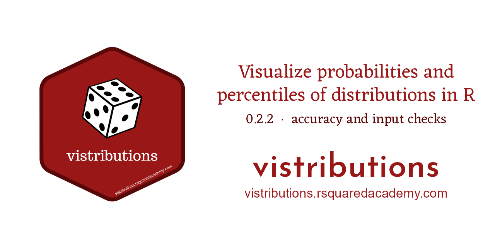

vistributions 0.2.2

{fig-alt="vistributions hex logo next to the tagline Visualize probabilities and percentiles of distributions in R, the line 0.2.2, accuracy and input checks, the package name vistributions and vistributions.rsquaredacademy.com" width="100%"}

```{r}
#| label: setup
#| include: false
library(vistributions)
stopifnot(packageVersion("vistributions") == "0.2.2")
```

vistributions draws the probability and percentile questions you ask of the normal, t, chi-square, F and binomial distributions, with the answer printed on the plot.

Version 0.2.2 is a correctness release. What the plot shades and what its caption prints now agree with the exact probability, and inputs that cannot describe an event stop with a clear message. If you use the binomial functions to size an event, read the first section.

## Install from CRAN

```{r}
#| label: install
#| eval: false
install.packages("vistributions")
```

The full list of changes is in the [release notes](https://vistributions.rsquaredacademy.com/news/).

## Shading follows the event

How likely is it that exactly 10 of 200 visitors sign up, when 5% of visitors usually do?

```{r}
#| label: binom-exact
#| fig-width: 7
#| fig-height: 4.5
#| fig-alt: "Binomial distribution of sign-ups out of 200 visitors at a 5% rate, with the bar for exactly 10 sign-ups shaded and the caption P(X = 10)."
vdist_binom_prob(n = 200, p = 0.05, s = 10, type = "exact")
```

The exact value, from base R:

```{r}
#| label: binom-check
dbinom(10, size = 200, prob = 0.05)
```

The caption and the shaded bar match this value. The change matters most for large `n`, where bars are grouped. A grouped bar that crossed the cutoff was painted whole: for `n = 10000`, `p = 0.01` and `s = 100`, the shaded area was 19.26% for an event whose exact probability is 4.01% ([release notes](https://vistributions.rsquaredacademy.com/news/)). Every event cutoff is now a bar edge, so the shaded bar heights add up to `dbinom()` or `pbinom()` for the event.

## Inputs that cannot be an event

A count of successes has to lie between 0 and the number of trials. Asking for a negative count used to be accepted and labelled with a probability of a different event. It now gives the same clear error as a count above `n`:

```{r}
#| label: binom-error
tryCatch(
  vdist_binom_prob(n = 10, p = 0.3, s = -1, type = "lower"),
  error = function(e) conditionMessage(e)
)
```

The same release adds checks for the other families, for example whole-number arguments for the binomial and a documented range for percentile probabilities (`1e-12 < probs < 1 - 1e-12`).

## Percentiles under a decimal comma

Delivery times are about 48 hours on average, with a standard deviation of 6 hours. By what time have 95% of orders arrived?

With `options(OutDec = ",")`, which is common in European locales, every percentile and probability export used to fail with `NAs introduced by coercion`. The decimal mark is now fixed to `.` wherever numbers are printed and parsed back:

```{r}
#| label: outdec
#| fig-width: 7
#| fig-height: 4.5
#| fig-alt: "Normal distribution of delivery times with mean 48 hours and standard deviation 6 hours, the lower 95% shaded and the 95th percentile cutoff marked."
old <- options(OutDec = ",")
vdist_normal_perc(probs = 0.95, mean = 48, sd = 6, type = "lower")
options(old)
```

```{r}
#| label: outdec-check
qnorm(0.95, mean = 48, sd = 6)
```

## Other improvements

- Continuous percentile probabilities and the normal scale have documented limits, and every limit stops with its own message.
- Captions print enough digits for the percentage they show, including probabilities below 0.1%.
- Binomial captions put the inequality inside `P()`, for example `P(X >= 4)`, and round once from the exact probability.
- `vdist_t_*()`, `vdist_chisquare_*()` and `vdist_f_*()` no longer truncate non-integer degrees of freedom.
- Plot grids have a bounded number of points, however large the scale.
- The tests that run on CRAN are much shorter, and the maintainer address is now aravindhebbali@rsquaredacademy.com.

The release notes carry the rest.

## Documentation

Documentation and examples for every function are at [vistributions.rsquaredacademy.com](https://vistributions.rsquaredacademy.com). Report problems at [github.com/rsquaredacademy/vistributions/issues](https://github.com/rsquaredacademy/vistributions/issues).
