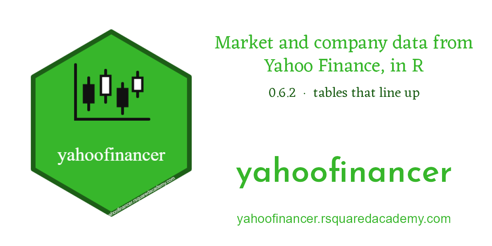

yahoofinancer 0.6.2

{fig-alt="yahoofinancer hex logo next to the tagline Market and company data from Yahoo Finance, in R, the line 0.6.2, tables that line up, the package name yahoofinancer and yahoofinancer.rsquaredacademy.com" width="100%"}

```{r}
#| label: setup
#| include: false
suppressWarnings(library(yahoofinancer))
stopifnot(packageVersion("yahoofinancer") == "0.6.2")
```

`yahoofinancer` fetches prices, quotes and company financials from Yahoo Finance into R: one tidy table per call, a row per symbol per day, and fields named after the figures on the Yahoo Finance pages.

Version 0.6.2 is on CRAN. The last post here introduced the package in 2022, and there have been five CRAN releases since. This one rebuilds the tables around the dates Yahoo reports, and it gives a failed request a predictable shape:

- Every valuation figure now joins its own observation date, and a metric Yahoo does not publish is an empty column.
- A request that fails for every symbol returns a zero-row tibble with the documented columns, not a zero-column one.
- Switching `Ticker$symbol` loads the new symbol's quote.
- `validate()` keeps symbols with dots, such as `VOD.L`, and returns them in your spelling and order.

If you read `Ticker$valuation_measures`, switch symbols on one `Ticker`, or check symbols before a batch download, the next four sections show what changed. Everyone else can start at [Other improvements](#other-improvements).

You can install it from CRAN with:

```{r}
#| label: install-cran
#| eval: false
install.packages("yahoofinancer")
```

The full list of changes is in the [release notes](https://yahoofinancer.rsquaredacademy.com/news/).

::: {.ba-note}
How we checked: every output in this post was produced by the code shown, run on 28 November 2026 against yahoofinancer 0.6.2 from CRAN. The comparisons use the same calls on 0.6.1, installed from the CRAN archive. Quotes are a snapshot of the last session, Friday 27 November.
:::

The data comes from Yahoo Finance's public endpoints, which the package does not control. A value is as correct as Yahoo's record for that symbol, and a quote is the last traded price at the time of the call.

## Every valuation figure keeps its own quarter

Which quarter does this figure belong to?

`Ticker$valuation_measures` returns market capitalisation, enterprise value and the price ratios, one row per observation date. The series do not all start on the same quarter: Berkshire Hathaway has a market capitalisation for 2025-06-30 but no price ratio, and a price ratio for 2025-09-30 but no market capitalisation.

```{r}
#| label: valuation-brk
brk <- Ticker$new("BRK-B")
brk_valuation <- brk$valuation_measures
brk_valuation[, c("date", "market_cap", "pe_ratio", "pb_ratio")]
```

Each row is one date with the figures Yahoo reports for that date. A metric Yahoo does not publish for a symbol is an empty column, so `enterprise_value_ebitda_ratio` is `NA` for Berkshire in every quarter.

In 0.6.1 the same call stopped with `Tibble columns must have compatible sizes`, because a series with no values could not join the table. That happened for Berkshire (`BRK-B`) and for Toyota (`7203.T`). In 0.6.2 the rows Yahoo has are returned, with `NA` where a metric is absent.

For two companies with complete series, the same field draws the comparison a reader expects:

```{r}
#| label: fig-market-cap
#| fig-cap: "Market capitalisation by quarter, AAPL and MSFT."
#| fig-alt: "Line chart of quarterly market capitalisation in trillions of US dollars for AAPL and MSFT from September 2025 to September 2026. AAPL rises from 3.76 to 4.84 trillion dollars. MSFT falls from 3.85 trillion dollars to 2.75 trillion in March 2026 and recovers to 3.81 trillion by September."
#| fig-width: 7
#| fig-height: 4
library(ggplot2)
valuation <- rbind(
  transform(Ticker$new("AAPL")$valuation_measures[, c("date", "market_cap")], symbol = "AAPL"),
  transform(Ticker$new("MSFT")$valuation_measures[, c("date", "market_cap")], symbol = "MSFT")
)
ggplot(valuation, aes(date, market_cap / 1e12, colour = symbol)) +
  geom_line(linewidth = 1) +
  geom_point(size = 2) +
  scale_colour_manual(values = c(AAPL = "#1d5e17", MSFT = "#37b62b")) +
  labs(x = NULL, y = "Market capitalisation (US$ trillion)", colour = NULL) +
  theme_minimal(base_size = 12) +
  theme(legend.position = "top", panel.grid.minor = element_blank())
```

**What to do:** re-run any valuation table built on a symbol with sparse metrics. The table now returns rows, and each figure sits on the quarter it describes.

## A failed request returns an empty table with the documented columns

What do you get when a symbol fails?

A batch download keeps the symbols that worked and warns about the one that did not:

```{r}
#| label: failed-symbol-partial
prices <- yf_download_prices(c("AAPL", "NOTASTOCK"), start = "2025-11-03", end = "2025-11-08")
prices
```

When every symbol in the call fails, the result is a zero-row tibble with the same eight columns:

```{r}
#| label: failed-symbol-full
failed <- yf_download_prices("NOTASTOCK", start = "2025-11-03", end = "2025-11-08")
failed
```

In 0.6.1 this case returned a zero-row, zero-column tibble, so a later `prices$close` warned with `Unknown or uninitialised column` and returned `NULL`. In 0.6.2 the columns are the documented ones: `symbol`, `date`, `open`, `high`, `low`, `close`, `adj_close` and `volume`. The same contract applies to `yf_get_market_stats()`, `yf_get_index_quotes()`, `yf_get_financials()` and `Tickers$get_history()`.

**What to do:** a zero-row result with the documented columns can go straight into a bind or a loop, with the warning as the only signal that a symbol was missed.

## A switched ticker reports its own quote

One object, two companies: which price do you get?

Quote fields are cached on the `Ticker` object, so a dashboard that changes symbol does not pay for the same metadata twice. The cache is now keyed by symbol:

```{r}
#| label: switch-symbol
stock <- Ticker$new("AAPL")
stock$regular_market_price
stock$symbol <- "MSFT"
stock$regular_market_price
```

The first value is Apple's last price, the second Microsoft's, read from the same object. In 0.6.1 the second line still printed 358.54, Apple's price, because the cache was not tied to the symbol.

The cache has no time expiry. For a fresh price on the same symbol, create a new `Ticker` or call `set_symbol()` again. `set_symbol()` clears the cache in both versions.

**What to do:** if one `Ticker` object is reused across symbols, check the quote after the switch. It now belongs to the symbol you asked for.

## A dotted symbol validates

Will the symbol check agree with the download?

`validate()` returns the symbols Yahoo recognises, so a typo is caught before a batch call:

```{r}
#| label: validate-dotted
validate(c("VOD.L", "AAPL", "NOTASTOCK"))
```

Vodafone's London listing (`VOD.L`) and `AAPL` come back; the misspelling does not. In 0.6.1 the same call returned only `AAPL`: the dot was trimmed from each response name before the match, so `VOD.L` dropped out.

The names come back in the spelling and order you passed; `validate(c("vod.l", "aapl"))` returns `"vod.l"` and `"aapl"`. With `return_logical = TRUE`, the result is a named logical vector in the same order, ready to filter a symbol vector:

```{r}
#| label: validate-logical
validate(c("MSFT", "AAPL"), return_logical = TRUE)
```

**What to do:** nothing, if your symbols have no dots. For exchange-suffixed symbols, the check now keeps the ones Yahoo lists.

## Other improvements

- `currency_converter()` warns and falls back to `close` when Yahoo returns a shorter adjusted-close series, instead of recycling the values it has. Missing quote fields give `NA`, and an empty chart gives an empty tibble.
- `yf_get_market_stats()` fetches metadata once per symbol, warns when it cannot, and always returns typed numeric and character columns.
- Malformed endpoint responses and unexpected non-object JSON give a warning and `NULL`;
  financial statements accept a plain numeric `reportedValue` and use `NA` for missing values.
- The default test suite blocks unmocked requests, so a test run cannot depend on Yahoo's uptime. Setting `YF_LIVE_TESTS=true` turns on the opt-in live smoke test.

The release notes carry the rest.

## What's next

Nothing in 0.6.2 closes an open issue, and none of the open issues affects the results above. They are feature and documentation requests:

- Screens and scores: a screener query engine (#38), momentum and Darvas box screens (#41), Piotroski and Altman scores (#39), Magic Formula and Graham screens (#40), a peer comparison matrix (#43), CAGR scorecards (#36), ownership patterns (#37) and health diagnostics (#42).
- The data engine: parallel batch fetching (#34), a disk and session cache (#33), cookie and crumb session management for authenticated endpoints (#56), a `yf_status()` connectivity and rate-limit check (#31) and a nightly live canary test (#35).
- Other requests: multi-tab Excel export (#44), an NSE/BSE suffix helper with an Indian-markets guide (#32) and an ESG screening guide (#58).

No fix version is set for these. The [issue tracker](https://github.com/rsquaredacademy/yahoofinancer/issues) is the place to follow them.

## Acknowledgements

Thank you to everyone who reported a problem or asked a question since the 2022 introduction: [&#x0040;complexgenome](https://github.com/complexgenome), [&#x0040;FV83](https://github.com/FV83), [&#x0040;inoddy](https://github.com/inoddy), [&#x0040;John2025-git](https://github.com/John2025-git), [&#x0040;MarcT48](https://github.com/MarcT48), [&#x0040;mg64ve](https://github.com/mg64ve), and [&#x0040;rpenm](https://github.com/rpenm).
